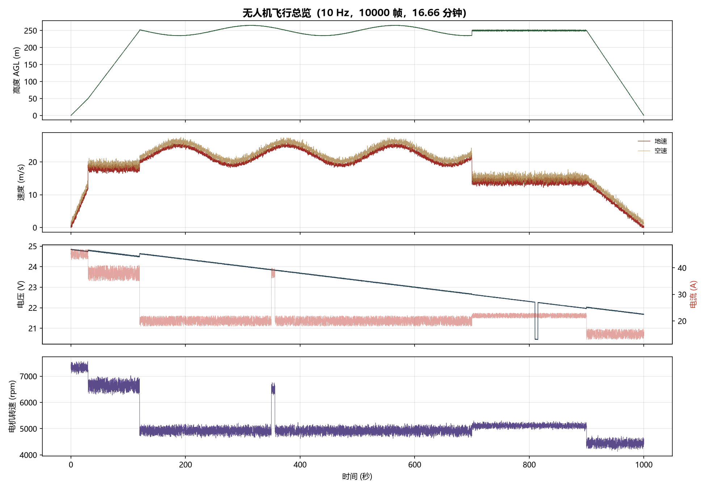
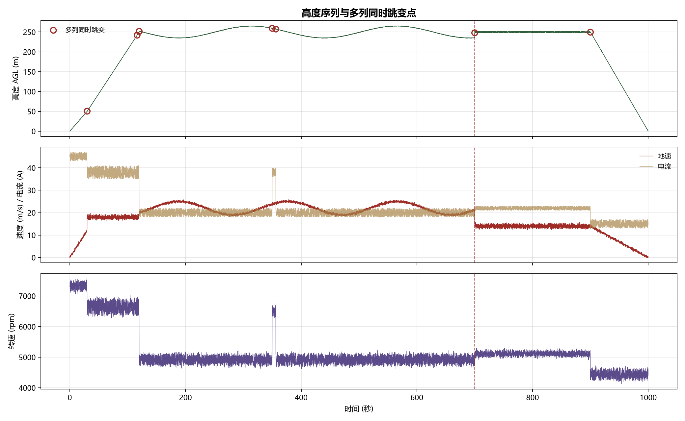
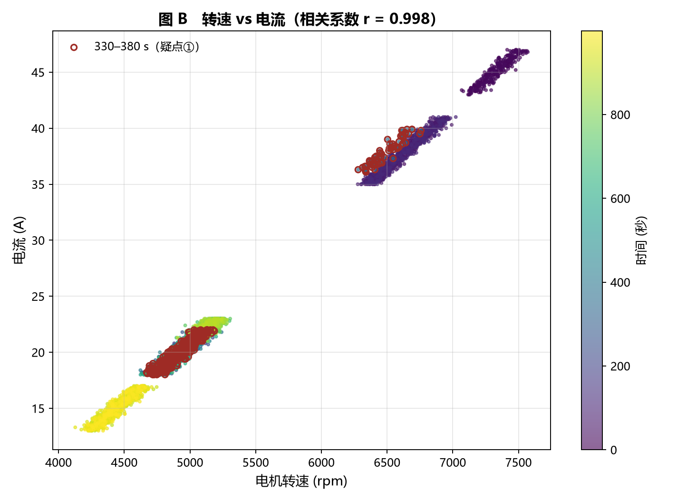
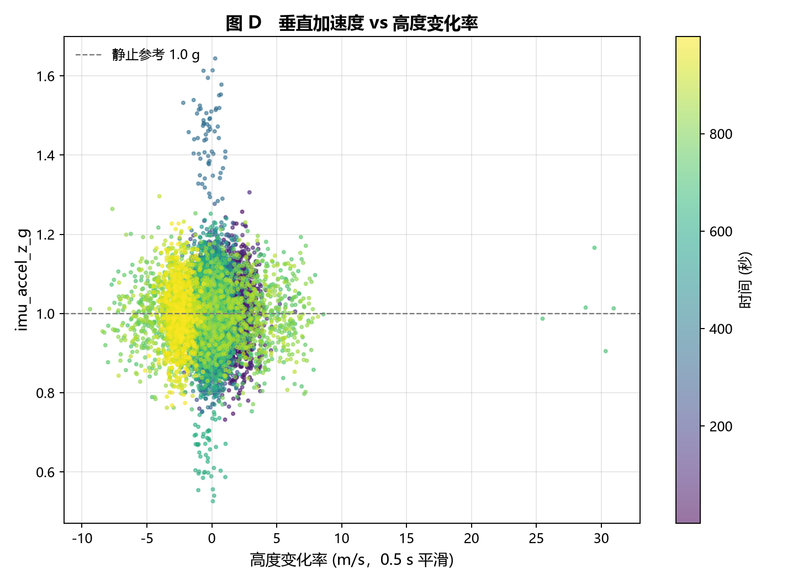
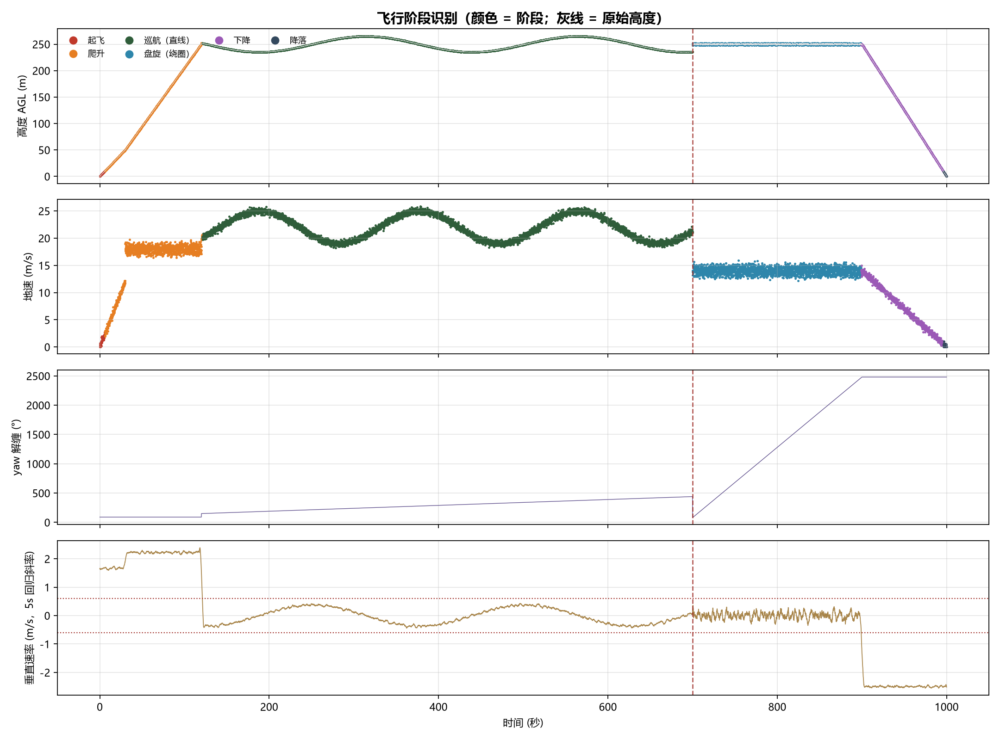
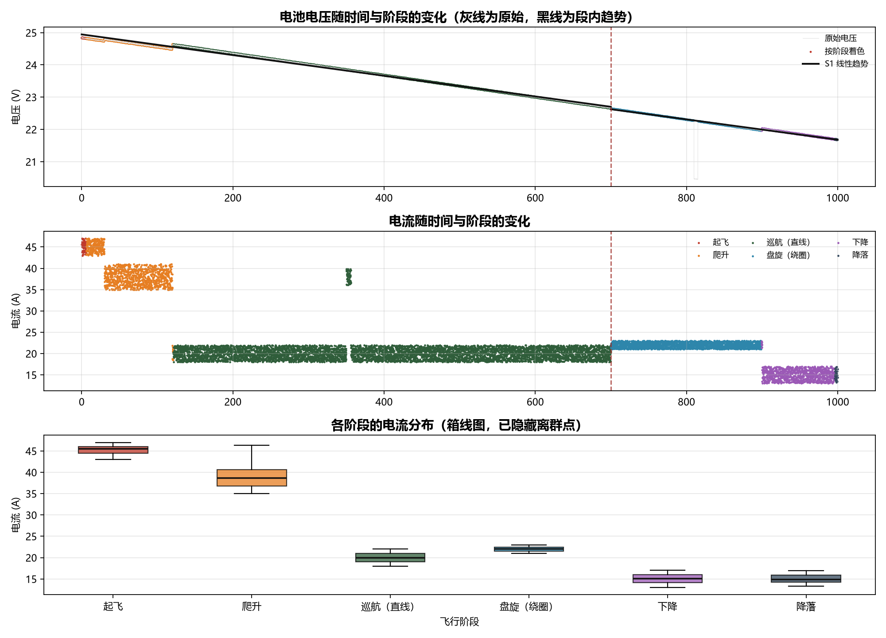
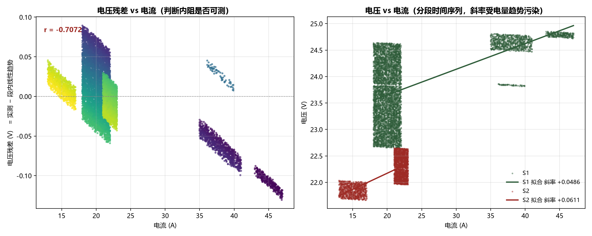
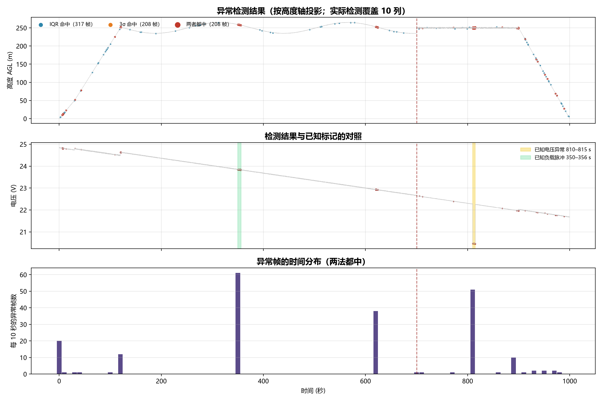

# 《Python数据分析编程》项目报告

**报告题目：** 无人机飞行遥测数据的清洗、阶段重建与异常检测

**学　　院：**（待填）
**专　　业：**（待填）
**学　　号：**（待填）
**学生姓名：**（待填）
**课　　程：** Python数据分析编程

---

## 摘　要

本项目以一段时长 999.9 秒、采样频率 10 Hz 的无人机飞行遥测数据（10000 行 × 13 列）为对象，完成了从数据清洗到异常归因的完整分析流程。

与常见的数据集不同，本数据**不存在缺失值和重复记录，时间轴也完全连续**，因此清洗工作的重心并非「补缺去重」，而是**「在看似正常的时序中识别出被掩盖的数据问题」**。本文建立了一套以**多通道物理自洽性**为核心的异常判据：当某一通道发生跳变时，检查其他通道（运动、姿态、动力、能源）是否同步响应，若只有单一通道变化而其余通道保持静止，则判为数据问题而非真实事件。

依据该判据，本文从 7 处统计可疑点中识别出 3 类性质完全不同的事件：**1 处数据替换（700.0 s）、1 处传感器读数平移（810.0–815.0 s）、1 处真实负载脉冲（350.0–356.1 s）**，其余 4 处为正常工况切换。

在此基础上，本文采用「垂直与水平分层」的两阶段方法重建了完整飞行过程（起飞、爬升、巡航、盘旋、下降、降落共 6 段），其中垂直速率通过 5 秒滑动窗口线性回归斜率估计，有效克服了原始高度序列的强噪声干扰。

在电池分析中，本文发现电压与电流的**直接回归斜率为正**（与内阻压降的物理规律相反），其根因是「电量随时间下降」这一混杂变量。通过先剔除段内线性趋势再对残差回归，得到内阻约 **3.0–4.5 mΩ**，残差与电流的相关系数达 −0.60 ~ −0.74。该案例说明：**时序数据中的相关关系不能直接解释为因果关系。**

最后，本文以 IQR 与 3σ 两种准则在「数据段 × 飞行阶段」分组内完成异常片段检测，共识别 6 个候选片段，并通过对照实验证明：**若不做分组而直接全局检测，会产生约 3.2 倍（1414 帧）的假阳性。**

**关键词：** 无人机遥测；多通道自洽性；异常检测；飞行阶段识别；混杂偏倚；IQR 准则

---

## 1. 引言

### 1.1 项目背景

无人机在飞行过程中会持续产生大量遥测数据，涵盖位置、姿态、动力与能源等多个子系统。这些数据既是飞行安全的监控依据，也是事后事故分析的关键证据。然而，实际采集到的数据往往并非「干净」的：传感器漂移、采样丢帧、记录拼接、通信干扰等问题都会在时序中留下痕迹，且这些痕迹**常常与真实的飞行事件在数值上难以区分**。

如果直接把数据当作可信输入进行分析，那么一个被替换的数据段就可能被误读为「一次剧烈的机动」，进而得出完全错误的结论。因此，**异常识别不只是数据清洗的一个环节，也是整个分析结论可靠性的前提**。

### 1.2 数据来源

数据文件为 `题1_无人机飞行遥测.csv`，由课程提供，记录了一次完整的无人机飞行过程。

### 1.3 分析目标

依据课程要求，本项目需要完成五项任务：

1. 清洗数据，处理缺失值、重复记录与明显异常点；
2. 按时间重建飞行过程，识别起飞、爬升、巡航、盘旋、降落等飞行阶段；
3. 分析电池电压、电流随时间的变化，研究其与电机转速、飞行阶段的关系；
4. 至少使用一种方法检测异常飞行片段，并结合业务背景解释；
5. 用图表清晰展示分析结论。

### 1.4 分析思路

本文的核心方法论可以概括为一句话：

> **不要只看变化的幅度大不大，而要看「变化的那几层」是不是同时变化、方向是否一致、量级是否匹配。自洽则判为真实事件，矛盾则判为数据问题。**

这一判据建立在无人机的物理结构之上：一架多旋翼无人机的遥测数据在物理上可以划分为五个层次，彼此之间存在明确的因果链。

| 层次 | 含义 | 对应字段 |
|---|---|---|
| 时间层 | 一切变化的自变量 | `timestamp_ms` |
| 运动层 | 机体在空间中的位置与速度 | `altitude_agl_m`、`ground_speed_mps`、`airspeed_mps` |
| 姿态层 | 机体的朝向与倾斜 | `roll_deg`、`pitch_deg`、`yaw_deg` |
| 动力层 | 产生推力与加速度 | `motor_rpm`、`imu_accel_z_g` |
| 能源层 | 为动力层供能 | `battery_voltage_v`、`battery_current_a` |
| 导航质量层 | 定位可信度 | `gps_satellites`、`gps_hdop` |

**因果链的方向是：能源决定动力，动力决定姿态，姿态决定运动。** 因此判据可以反向使用：**若运动层发生了变化，动力层与能源层必然也要有相应的变化**。如果运动层「凭空变化」而能源与动力层毫无反应，那么这变化就不可能是真实发生的。

---

## 2. 数据介绍

### 2.1 数据规模

| 项目 | 数值 |
|---|---|
| 行数 | 10,000 |
| 列数 | 13 |
| 采样频率 | 10 Hz（步长 100 ms） |
| 总时长 | 999.9 s（约 16.7 分钟） |
| 文件大小 | 718 KB |

### 2.2 字段说明

| 字段名 | 物理含义 | 单位 | 实测范围 |
|---|---|---|---|
| `timestamp_ms` | 时间戳 | ms | 0 – 999,900 |
| `altitude_agl_m` | 相对地面高度 | m | 0.07 – 265.73 |
| `ground_speed_mps` | 地速（相对地面） | m/s | 0.00 – 25.83 |
| `airspeed_mps` | 空速（相对气流） | m/s | 均值 19.25 |
| `roll_deg` | 横滚角 | ° | — |
| `pitch_deg` | 俯仰角 | ° | — |
| `yaw_deg` | 偏航角（0–360，循环量） | ° | 0 – 359.95 |
| `battery_voltage_v` | 电池端电压 | V | 20.45 – 24.85 |
| `battery_current_a` | 放电电流 | A | 13.00 – 47.00 |
| `motor_rpm` | 电机转速 | rpm | 4,127 – 7,571 |
| `imu_accel_z_g` | 垂向加速度 | g | 约 1.0 |
| `gps_satellites` | 可见卫星数 | 颗 | 16 – 19 |
| `gps_hdop` | 水平精度因子 | — | 0.70 – 0.85 |

### 2.3 两个需要特别注意的字段特性

**① `yaw_deg` 是循环量。** 该字段取值 0–360，359° 与 1° 在数值上相差 358，但在物理上只差 2°。因此**任何涉及偏航角的差分或趋势分析，都必须先做角度解缠（unwrap）**，否则会产生大量虚假的剧烈转向。

**② 电压为 6S 锂电。** 满电约 25.2 V，空电约 18.0 V。本次飞行电压由 24.85 V 降至 21.67 V，单节约 4.14 V，即3.61 V，属于正常放电区间。

### 2.4 GPS 质量

可见卫星数 16–19 颗、HDOP 始终在 0.70–0.85 之间，属于**优**（HDOP < 1 即视为理想）。这一结论在后文有重要作用：**它可以排除「定位漂移导致数据异常」这一假说**，使得后续异常归因不必考虑导航层。

---

## 3. 数据清洗与预处理

### 3.1 数据体检：先确认「有什么问题」

在动手处理之前，先对数据做一次完整体检。结果如下：

| 检查项 | 结果 |
|---|---|
| 缺失值 | **0 个**（13 列全部完整） |
| 重复记录 | **0 行** |
| 时间轴连续性 | **完全连续**，步长恒为 100 ms，无跳变、无回退 |
| 数据类型 | 全部为数值型，无需转换 |
| 分类变量 | 无 |



**这一结果本身就是一个值得写入报告的发现：** 课程要求中提到「处理缺失值、重复记录」，但在这份数据上，这两项工作**不存在**。因此本项目的清洗重心必须从「补缺去重」转向「识别异常」。

> **【分析对象的说明】** 正因为缺失与重复都不存在，本文把清洗阶段的全部精力投入到「异常点识别」上。若按常规流程仅做缺失值检查便宣告清洗完成，后续所有分析都将建立在未经检验的数据之上。

### 3.2 异常点识别：从 7 个可疑点到 3 类结论

#### 3.2.1 第一步：定位可疑点

直接对全部 13 列做逐帧差分，噪声极大。故采用**分位数自适应阈值**替代人工设定阈值：

1. 对每一列计算其差分绝对值的 **99.9 分位**作为自适应阈值；
2. 只有**同时有 ≥2 列**超过各自阈值时，才记为候选点。

这样做的理由是：单列超阈可能只是噪声，而多列同时超阈才意味着**某个物理量发生了系统性跳变**。

**最终定位出 7 个候选点：**

| 时刻 (s) | 高度 Δ | 地速 Δ | 电流 Δ | 转速 Δ | z 轴 | 初步判定 |
|---|---|---|---|---|---|---|
| 30.0 | +0.52 | +6.77 | −5.6 | −471 | 1.030 | 待定 |
| 116.4 | −0.39 | +0.10 | +5.6 | +583 | 0.963 | 待定 |
| 120.0 | +2.32 | +1.48 | −13.5 | −1345 | 0.967 | 待定 |
| **350.0** | −0.57 | +0.36 | **+18.1** | **+1550** | 1.327 | 待定 |
| **356.1** | −0.15 | +0.43 | **−18.1** | **−1516** | 1.103 | 待定 |
| **700.0** | **+12.59** | **−7.07** | +1.9 | +29 | 0.905 | 待定 |
| 900.0 | +0.29 | +0.32 | −8.5 | −757 | 1.034 | 待定 |



#### 3.2.2 第二步：用多通道自洽性逐一判定

**（1）四处置信度低的跳变（30.0 / 116.4 / 120.0 / 900.0 s）**

四处均呈现相同特征：**电流与转速大幅同步跳变，而高度与地速基本不动。**

| 时刻 | 电流 Δ | 转速 Δ | 高度 Δ | 地速 Δ |
|---|---|---|---|---|
| 30.0 | −5.6 A | −471 rpm | +0.52 m | +6.77 m/s |
| 116.4 | +5.6 A | +583 rpm | −0.39 m | +0.10 m/s |
| 120.0 | −13.5 A | −1345 rpm | +2.32 m | +1.48 m/s |
| 900.0 | −8.5 A | −757 rpm | +0.29 m | +0.32 m/s |

能量层与动力层同步、同向、量级匹配，运动层几乎不变。**物理自洽，即判定为飞行模式切换（如切换航线、改变速度上限），不是数据问题，予以保留。**

**（2）350.0–356.1 s：真实负载脉冲**

- 350.0 s：电流 **+18.1 A**、转速 **+1550 rpm**，同时跳变且方向一致；
- 356.1 s：**−18.1 A / −1516 rpm**，反向精确恢复；
- 期间高度仅变化 10.65 m（252.10，即262.75 m），地速基本不变；
- `imu_accel_z_g` 出现 1.327 g 的峰值，说明确有向上加速度。

能量、动力、姿态三层的响应方向一致、量级匹配、时间统一。**判定为真实的负载脉冲（机体在保持高度的前提下加大功率），属于有效飞行事件，保留并仅作标记。**



> **【关键对照】** 这一点与后文的 700 s 形成鲜明对比：350 s 是「能量与动力一起变，运动没变」，700 s 是「运动说变了，能量说没变」。仅凭变化幅度无法区分二者，必须靠通道间的自洽性。

**（3）700.0 s：数据替换 —— 本项目的核心发现**

单帧变化：高度 **+12.59 m**、地速 **−7.07 m/s**，而电流仅 +1.9 A、转速仅 +29 rpm。

**自洽性检验：**

| 检验项 | 数值 | 是否合理 |
|---|---|---|
| 若真爬升 12.59 m，所需垂直速度 | 125.9 m/s（**453 km/h**） | 否 远超小型多旋翼能力上限（5–8 m/s） |
| 加速度计 z 轴读数 | 0.905 g（正常） | 否 有机体位移却无加速度响应 |
| 电流变化 | +1.9 A（约 8%） | 否 位置大幅变化却不耗能 |
| 转速变化 | +29 rpm（约 0.6%） | 否 同上 |

**前后 50 秒的均值对比：**

```
700 前（650–699 s）：高度 237.14　地速 19.67　电流 19.94　转速 4912
700 后（700–749 s）：高度 250.01　地速 14.03　电流 21.97　转速 5108

偏移：高度 +12.9 m　地速 −5.6 m/s　电流 +2.0 A　转速 +196 rpm
```

**矛盾之处非常明确：地速下降 5.6 m/s 的同时电流反而上升 2.0 A**，这与「减速应减少功率」的物理规律相反；转速仅增加 196 rpm，也不足以解释 12.9 m 的高度抬升。

**判定：700 s 处不是机体发生了运动，而是数据本身被替换。** 最可能的成因是两条飞行记录被拼接，或传感器重连后基线发生漂移。



**处理方式不是删除某一行，而是分段。** 因为被替换的不是单个数值，而是**从 700 s 起整段的基线**——删除 700.0 s 那一行后，其后数据仍属另一条基线，问题不会消失。故将数据切分为 S1（0.0–699.9 s，7000 帧）与 S2（700.0–999.9 s，3000 帧），**此后所有跨段分析必须先按段隔离**。

**（4）810.0–815.0 s：传感器读数平移**

这一步是本项目耗时最长的一处归因。

**观察：全序列「电压一跳 ≥1 V」的帧只有 2 帧——**

```
810.0 s：22.27 V → 20.46 V，Δ = −1.81 V
815.1 s：20.45 V → 22.26 V，Δ = +1.81 V
```

中间 51 帧（5.1 秒）电压稳定在 20.45–20.48 V，呈**矩形**而非 V 形。

**关键对比：**

| 窗口 | 电压均值 | 电流均值 |
|---|---|---|
| 前 10 秒（800–810 s） | 22.287 V | 22.04 A |
| **凹陷窗（810–815 s）** | **20.461 V** | **22.06 A** |
| 后 10 秒（815–825 s） | 22.236 V | 21.97 A |

**电压下降 1.826 V，而电流仅变化 +0.016 A（千分之三），转速均值变化 +1 rpm。**

**三种假说全部排除：**

| 假说 | 应有现象 | 实际观察 | 结论 |
|---|---|---|---|
| 内阻压降（大电流拉低电压） | 电流同步大幅上升 | 电流仅 +0.016 A | 否 |
| 电池电量耗尽 | 电压单调下降 | 矩形，5.1 s 后精确恢复 | 否 |
| 采样毛刺 | 单帧尖峰 | 持续 51 帧，两端幅度几乎相等（1.81 / 1.81） | 否 |

**判定：电压通道的读数被整体平移了 1.826 V，5.1 秒后精确恢复。这属于采集链路异常，不是电池的电学现象。**

**处理：标记并剔除这 51 帧的电压值**（`voltage_usable = False`），因为它们本身是错的，直接用于电池分析会得出错误结论；但其他通道（电流、转速、高度）在该时段正常，予以保留。

#### 3.2.3 三处关键结论的横向对照

| 项目 | 时刻 | 跳变的通道 | 未变的通道 | 判定 | 处理 |
|---|---|---|---|---|---|
| 350 s 负载脉冲 | 350.0–356.1 | 电流、转速 | 高度、地速 | 真实负载 | 保留 + 标记 |
| **700 s 数据替换** | 700.0 | **高度、地速** | 电流、转速、z 轴 | **数据拼接** | **分段** |
| **810 s 电压平移** | 810.0–815.0 | **电压** | 电流、转速、高度 | **采集链路异常** | **剔除 + 标记** |

**这张表回答了一个容易被误解的问题：所谓「异常点之间的关联」，指的不是它们由同一原因造成，而是它们可以被同一套判据分门别类。**

```
真实事件 → 变了的那几层，物理上能互相解释
数据问题 → 只有一层变了，其他层说「没发生」
```

### 3.3 派生特征与标记

在清洗结论的基础上，构造了以下列供后续分析直接使用：

| 列名 | 含义 |
|---|---|
| `segment` | 所属数据段（S1 / S2） |
| `is_segment_break` | 数据替换帧标记 |
| `is_load_pulse` | 真实负载脉冲窗口 |
| `is_voltage_glitch` | 电压不可信窗口 |
| `is_mode_switch` | 工况切换时刻 |
| `alt_rate_smooth` | 段内平滑后的垂直速率 |
| `yaw_unwrap` | 解缠后的偏航角 |
| `voltage_usable` | 电压可用性 |
| `height_usable` | 高度变化率可用性 |

**标记后的可用性统计：**

```
总行数 10000
S1（0–699.9 s） 7000 帧
S2（700–999.9 s） 3000 帧

电压可用 9949 / 10000（剔除 51 帧，占 0.51%）
高度可用 9998 / 10000
```

> **【说明】** 99.5% 的数据是可用的。这份数据的「脏」不在于大面积缺失，而在于**少量单通道阶跃——肉眼看不出来，但会毁掉跨段的统计**。

---

## 4. 飞行过程重建：阶段识别

### 4.1 方法设计

**（1）为什么分两层**

无人机的垂直运动与水平运动是两个**独立的自由度**：垂直方向由总油门决定，水平方向由姿态倾斜与航向决定。因此阶段识别不应把所有特征塞进一个多维阈值，而应分层：

```
第 1 层（垂直状态）：地面 → 降落 → 起飞 → 爬升 → 下降 → 平飞
第 2 层（水平状态）：仅对「平飞」按偏航角速度细分 → 盘旋 / 巡航
```

**这样做的直接好处是不会出现「下降 + 绕圈」这类无法归类的混合态。**

**（2）垂直速率的估计——本项目踩过两个坑**

| 版本 | 方法 | 结果 | 失败原因 |
|---|---|---|---|
| 第 1 版 | 直接对逐帧高度求差分 | 爬升被切成 **144 段**，下降 **145 段** | 高度序列本身噪声极大 |
| 第 2 版 | 先取 5 秒滚动中位数，再差分 | 碎片化消失，但**起飞识别不出来**，且 S2 误判为 57.8% 在下降 | ①中心窗口边界偏置；②噪声非零均值，中位数压不掉 |
| **第 3 版（采用）** | **5 秒滑动窗口线性回归斜率** | 干净 | — |

**原始高度噪声实测（逐帧差分绝对值）：**

```
S1：均值 0.291 m，95% 分位 0.720 m，最大 2.32 m
S2：均值 1.043 m，95% 分位 2.980 m，最大 4.54 m

全序列均值 0.518 m/帧 → 相当于 5.2 m/s 的「表观垂直速度」
 已超过小型多旋翼的物理上限（5–8 m/s）
```

**这说明：不处理噪声就直接定阈值是无效的，因为噪声量级本身已超过阈值。**

**第 3 版的效果验证（各窗口实测垂直速率）：**

| S1 窗口 | 速率 (m/s) | S2 窗口 | 速率 (m/s) |
|---|---|---|---|
| 0–30 s | **+1.665** | 700–750 s | **0.000** |
| 30–60 s | **+2.224** | 750–800 s | **0.001** |
| 60–90 s | **+2.221** | 800–850 s | **0.001** |
| 90–120 s | **+2.222** | 850–900 s | **−0.008** |
| 120–150 s | −0.357 | 900–950 s | **−2.500** |
| 150–700 s | ≈ 0 | 950–1000 s | **−2.500** |

**平飞精确到 0.000，匀速下降精确到 −2.500，匀速爬升稳定在 +2.22。**

**（3）阈值设定**

| 参数 | 取值 | 依据 |
|---|---|---|
| 地面高度 | < 2 m | 全序列仅 22 帧，集中在起降两端 |
| 低空窗口 | < 10 m | 起飞 / 降落判别窗口 |
| 垂直速率阈值 | ±0.6 m/s | 平滑后噪声已降至 ±0.3 以内 |
| 偏航角速度阈值 | > 5 °/s | S1 中位数 0.50 °/s，S2 中位数 12.00 °/s，相差 24 倍，分离度极高 |
| 最短阶段时长 | 2 s | 短于此视为过渡抖动，并入相邻阶段 |

### 4.2 识别结果

**共识别出 6 个飞行阶段：**

| # | 段 | 阶段 | 起 (s) | 止 (s) | 时长 (s) | 占全局 |
|---|---|---|---|---|---|---|
| 1 | S1 | **起飞** | 0.0 | 5.9 | 6.0 | 0.6% |
| 2 | S1 | **爬升** | 6.0 | 121.1 | 115.2 | 11.5% |
| 3 | S1 | **巡航（直线）** | 121.2 | 699.9 | 578.8 | 57.9% |
| 4 | S2 | **盘旋（绕圈）** | 700.0 | 899.1 | 199.2 | 19.9% |
| 5 | S2 | **下降** | 899.2 | 996.1 | 97.0 | 9.7% |
| 6 | S2 | **降落** | 996.2 | 999.9 | 3.8 | 0.4% |



### 4.3 结果解读

**（1）偏航角揭示了两个数据段的飞行模态完全不同**

| 段 | 累计偏航变化 | 平均角速度 | 中位角速度 | 飞行模态 |
|---|---|---|---|---|
| S1 | +350.0°（0.97 圈） | 0.50 °/s | 0.50 °/s | 直线飞行 |
| S2 | **+2398.8°（6.66 圈）** | 8.00 °/s | **12.00 °/s** | 匀速绕圈 |

**S2 段在 199.2 秒内以恒定 12 °/s 的速度绕了约 6.66 圈，而 S1 段几乎不转。**

> **【这是第三处支持「700 s 为数据拼接」的证据】** 前两条证据是物理量层面的（基线平移、噪声强度相差 3.6 倍），这一条是**飞行意图层面**的：两段的飞行任务根本不同——一段直线高速飞行，一段绕圈低速飞行。**这不是同一趟飞行的两个阶段，而是两次不同的飞行被拼在了一起。**

**（2）巡航段的周期性波动得到解释**

S1 巡航段（121–700 s）中，高度与地速呈现同步的正弦波动（高度 245、265、245，地速 19、25、19，三次）。经检验：

- 该段垂直速率约 ±0.5 m/s，未超过 ±0.6 m/s 阈值，故判为平飞；
- 同期偏航角速度仅 0.5 °/s，**排除绕圈**；
- 高度上升与地速上升同步发生。

**判定：这是「定高巡航中为保持空速而调整油门」的行为，不是盘旋，也不是数据问题。**

---

## 5. 电池电压电流与飞行阶段的关系

### 5.1 按阶段统计

统计时已剔除 `voltage_usable = False` 的 51 帧。

| 阶段 | 时长 (s) | 电压均值 (V) | 电压范围 (V) | 电流均值 (A) | 转速均值 (rpm) | 功率均值 (W) | 能量 (Wh) |
|---|---|---|---|---|---|---|---|
| 起飞 | 6.0 | **24.828** | 24.81–24.85 | **45.25** | 7343 | **1123.5** | 1.873 |
| 爬升 | 115.2 | 24.670 | 24.47–24.83 | 39.20 | 6761 | 967.2 | 30.950 |
| 巡航（直线） | 578.8 | 23.644 | 22.65–24.64 | 20.18 | 4936 | 477.1 | 76.703 |
| 盘旋（绕圈） | 199.2 | 22.307 | 21.96–22.65 | 22.00 | 5112 | 490.8 | 26.460 |
| 下降 | 97.0 | 21.857 | 21.68–22.04 | 15.09 | 4447 | 329.7 | 8.885 |
| 降落 | 3.8 | 21.686 | 21.67–21.70 | 15.01 | 4434 | 325.6 | 0.344 |

**全飞行能量合计：145.22 Wh**



### 5.2 功率排序与物理一致性

```
起飞 1123.5 W > 爬升 967.2 W > 盘旋 490.8 W ≈ 巡航 477.1 W > 下降 329.7 W ≈ 降落 325.6 W
```

**这一排序说明：功率与「垂直速率」强相关，与「水平速度」弱相关。**

- 起飞功率最高：需同时提供升力与加速；
- 爬升次高：持续对抗重力做正功；
- 盘旋略高于巡航：绕圈需倾斜机体产生向心力，升力有一部分被消耗；
- 下降与降落最低：重力做负功，电机仅需维持姿态。

### 5.3 时间占比 ≠ 能量占比

| 阶段 | 时长占比 | 能量占比 | 比值 |
|---|---|---|---|
| **爬升** | **11.5%** | **21.3%** | **1.85** |
| 起飞 | 0.6% | 1.3% | 2.17 |
| 巡航 | 57.9% | 52.8% | 0.91 |
| 盘旋 | 19.9% | 18.2% | 0.91 |
| 下降 | 9.7% | 6.1% | 0.63 |
| 降落 | 0.4% | 0.2% | 0.50 |

**爬升只占 11.5% 的时间，却消耗了 21.3% 的能量。**

**由此得到的建议是：若要延长续航，优化爬升策略（如采用更平缓的爬升率）的收益，大于优化巡航策略。**

### 5.4 内阻测算：一个典型的混杂偏倚案例

**（1）问题：直接回归的斜率是「正」的**

对电压与电流直接做线性回归，得到的斜率与内阻压降的物理规律**相反**：

| 段 | 直接回归斜率 |
|---|---|
| S1 | **+0.0486 V/A** |
| S2 | **+0.0611 V/A** |

正的斜率意味着「电流越大电压越高」，这在内阻模型中不可能成立。

**（2）根因：电量下降是混杂变量**

```
端电压 = 开路电压(随时间下降) − 内阻压降(随电流变化)
```

数据是被动采集的时间序列，电压同时受两个因素影响。直接回归时，「电量随时间下降」这一趋势被错误地归因到了电流上。

**（3）解法：分离趋势与残差**

1. 对每一段用线性拟合近似「开路电压随时间下降」的部分：

```
S1：V = 24.945 − 0.003205·t　（每 100 s 下降 0.3205 V）
S2：V = 24.833 − 0.003154·t　（每 100 s 下降 0.3154 V）
```

2. 取残差 `r = V − (a + b·t)`，它近似等于「内阻压降 + 噪声」；
3. 对残差与电流做回归。

**（4）结果**

| 段 | 趋势 (/100s) | 残差 std (V) | 残差–电流 r | 斜率 (V/A) | 推算内阻 |
|---|---|---|---|---|---|
| **S1** | −0.3205 V | 0.0468 | **−0.7408** | **−0.0045** | **≈ 4.5 mΩ** |
| **S2** | −0.3154 V | 0.0169 | **−0.6009** | **−0.0030** | **≈ 3.0 mΩ** |

**两段的残差均与电流呈显著负相关，符号与内阻压降一致，推算内阻约 3.0–4.5 mΩ。**



**（5）方法论启示**

同一份数据、两种算法，结论符号相反：

| 方法 | 斜率 | 结论 |
|---|---|---|
| 直接回归 V ~ I | **+0.0486 V/A** | 「电流越大电压越高」← 荒谬 |
| 扣除时间趋势后回归 | **−0.0045 V/A** | 「电流越大电压越低」← 符合物理 |

**差别只在于是否控制了「时间」这一混杂变量。这说明：时序数据中的相关关系不能直接解释为因果关系，必须先排除随时间变化的混杂因素。**

### 5.5 电流与转速的关系（分阶段）

| 阶段 | 样本数 | 相关系数 r | 斜率 (A / 1000 rpm) |
|---|---|---|---|
| 起飞 | 60 | 0.9053 | 9.4983 |
| 爬升 | 1152 | 0.9943 | 10.2738 |
| 巡航（直线） | 5788 | 0.9787 | **10.6080** |
| **盘旋（绕圈）** | 1992 | 0.8087 | **7.1326** |
| 下降 | 970 | 0.9525 | 9.4247 |
| 降落 | 38 | 0.9270 | 9.4820 |

**盘旋段的斜率（7.13）显著低于其他阶段（9.4–10.6）。**

**但本文不对这一现象下结论，原因如下：**

```
盘旋全部发生在 S2，而 S1 与 S2 是两段拼接的数据（见 3.2.2）
→ 无法区分「盘旋这个动作更省电」与「S2 这段数据本身不同」
 要验证，需要有「同一段数据内盘旋与巡航的对照」，而这批数据没有
```

**这属于**混杂变量无法分离**的典型情形，如实写入局限，不强行解释。**

---

## 6. 异常飞行片段检测

### 6.1 方法设计

**（1）两种准则交叉验证**

| 准则 | 原理 | 特点 |
|---|---|---|
| **IQR** | Q1 − 1.5·IQR 与 Q3 + 1.5·IQR | 不假设分布；对极端值不敏感，稳健 |
| **3σ** | μ ± 3σ | 假设近似正态；均值与标准差本身会被离群值污染 |

两者都判为异常时置信度高；只有一种判为异常时需人工判断。

**（2）在「段 × 阶段」分组内检测，而非全局**

**（3）每组每列先去线性趋势**

有些列在某阶段内本就单调变化（如爬升阶段高度从 0 升到 250 m）。若直接对整段做 IQR，整个上升段的高值都会被判为异常。故先拟合 `x = a + b·t` 取残差再检测。对本来就平稳的列，趋势斜率≈0，不产生副作用。

**（4）片段判定**

连续 ≥ 10 帧（1 秒）才算「片段」，过滤单点噪声。

### 6.2 检测结果

| 段 | 阶段 | 样本数 | IQR 命中 | 3σ 命中 | 两者都中 |
|---|---|---|---|---|---|
| S1 | 巡航 | 5788 | 256 | 220 | 220 |
| S1 | 爬升 | 1152 | 122 | 83 | 83 |
| S2 | 下降 | 970 | 82 | 59 | 59 |
| S2 | 盘旋 | 1992 | 70 | 58 | 58 |
| S1 | 起飞 | 60 | 2 | 0 | 0 |
| S2 | 降落 | 38 | 2 | 0 | 0 |

**各列检出率（跨所有组）：**

| 列 | 两者都中 | 命中率 |
|---|---|---|
| `imu_accel_z_g` | 107 | **1.07%** |
| `motor_rpm` | 82 | 0.82% |
| `battery_current_a` | 81 | 0.81% |
| `battery_voltage_v` | 71 | 0.71% |
| `altitude_agl_m` | 28 | 0.28% |
| `roll_deg` | 20 | 0.20% |
| `pitch_deg` | 19 | 0.19% |
| `airspeed_mps` | 6 | 0.06% |
| `ground_speed_mps` | 6 | 0.06% |
| **`gps_hdop`** | **0** | **0.00%** |

**三条解读：**

1. **振动（imu）最不稳定**，命中率最高，符合加速度计对机体振动最敏感的物理直觉；
2. **GPS HDOP 零命中**，印证第 2.4 节的判断，可彻底排除「定位漂移导致异常」这一类假说；
3. **高度命中率低**（0.28%），是因为去趋势把正常的高度变化解释掉了，剩下的才是真正偏离趋势的部分。

### 6.3 异常片段清单

| # | 段 | 阶段 | 起 (s) | 止 (s) | 时长 | 涉及列 |
|---|---|---|---|---|---|---|
| 1 | S1 | 爬升 | 6.0 | 7.1 | 1.2 s | `altitude_agl_m` |
| 2 | S1 | 爬升 | 120.0 | 121.1 | 1.2 s | roll / pitch / V / I / rpm |
| 3 | S1 | 巡航 | **350.0** | **356.0** | **6.1 s** | I / rpm / imu |
| 4 | S1 | 巡航 | 620.3 | 621.2 | 1.0 s | `imu_accel_z_g` |
| 5 | S1 | 巡航 | 622.9 | 623.9 | 1.1 s | `imu_accel_z_g` |
| 6 | S2 | 盘旋 | **810.0** | **815.0** | **5.1 s** | `battery_voltage_v` |



### 6.4 交叉验证

| 已知标记 | 帧数 | IQR | 3σ | 两者都中 |
|---|---|---|---|---|
| **810 s 电压平移** | 51 | 51 | 51 | **51（100%）** |
| **350 s 负载脉冲** | 62 | 61 | 61 | **61（98.4%）** |
| 900 s 工况切换 | 3 | 0 | 0 | **0（0%）** |

**两个持续 5–6 秒的异常被 100% / 98.4% 检出，说明统计方法有效。**

**而 900 s 的工况切换（仅 3 帧、0.3 秒）完全未被检出——这不是方法缺陷，而是「片段」与「单点」的本质区别：**

```
统计方法需要足够样本才能判定离群
工况切换是「瞬间的状态跳变」，只有 3 帧
 它是被 3.2.2 节的多通道自洽性判据发现的

→ 结论：统计方法擅长「片段」，自洽性判据擅长「跳变」，两者互补而非替代
```

### 6.5 对照实验：全局检测会产生 3.2 倍假阳性

对同一列（`altitude_agl_m`）做两种检测：

| 检测方式 | 命中帧数 |
|---|---|
| **全局**（不分组，直接去趋势 + IQR） | **1,862** |
| **段内**（按 S1 / S2 分别处理） | **448** |
| 两者重叠 | 448（段内全部被全局包含） |
| **仅全局命中** | **1,414** ← 全为假阳性 |
| 仅段内命中 | 0 |

**全局检测 = 段内检测 + 1414 个假阳性（多 3.2 倍）。**

**根本原因：**

```
700 s 两侧是两条不同基线的数据（S1 均值 237 m，S2 均值 250 m）
全局线性拟合只能取一个斜率，拟合线夹在两者中间
→ S1 整体偏下、S2 整体偏上
→ 两段的「正常数据」都被判成异常
```

**这是第 3.2.2 节坚持「先分段再分析」的直接收益：如果没有做分段，本章将得到 1862 个「异常」，其中 76% 是假的。**

### 6.6 最终综合：统计异常 ≠ 业务异常

**6 个检出片段中，只有 1 个是真正的数据问题。**

| # | 片段 | 统计判定 | 业务判定 | 依据 |
|---|---|---|---|---|
| 1 | 6.0–7.1 s | 异常 | **正常** | 起飞瞬间高度快速上升，偏离趋势属必然 |
| 2 | 120.0–121.1 s | 异常 | **正常** | 到达巡航高度时的工况切换，多通道同步 |
| 3 | 350.0–356.0 s | 异常 | **正常** | 真实负载脉冲，电流与转速同步、高度不动 |
| 4 | 620.3–621.2 s | 异常 | **待查** | 仅 imu 一列，无其他通道佐证 |
| 5 | 622.9–623.9 s | 异常 | **待查** | 同上 |
| 6 | **810.0–815.0 s** | 异常 | **异常（真实）** | 单通道阶跃，其他通道不动 → 采集链路故障 |

**判据仍来自第 1.4 节的多通道自洽性：**

```
变了的那几层，物理上能互相解释 → 真实事件（保留）
只有一层变了，其他层说「没发生」 → 数据问题（处理）
```

**因此「检出 6 个异常」不等于「数据有 6 个问题」：**

```
3 个是真实的飞行行为，只是统计上偏离了趋势
2 个是待查的振动微扰（无实质影响，仅 imu 一列）
1 个需要处理：810 s 的电压
```

**这就是「结合业务背景解释」的实质：统计工具给出候选，业务判断给出结论。**

---

## 7. 总结与结论

### 7.1 主要发现

**（1）关于数据质量**

本数据无缺失、无重复、时间轴完全连续，因此清洗的重心是**异常识别**而非补缺去重。数据共含 **3 类性质完全不同的异常/事件**：

| 类型 | 位置 | 性质 | 处理 |
|---|---|---|---|
| 数据替换 | 700.0 s | 运动层跳变，能量动力层无响应 → 记录拼接 | 分段为 S1 / S2 |
| 传感器读数平移 | 810.0–815.0 s | 单通道阶跃 −1.826 V，5.1 s 后精确恢复 | 剔除该段电压值 |
| 真实负载脉冲 | 350.0–356.1 s | 能量、动力、姿态同步响应 → 真实机动 | 保留并标记 |

**（2）关于飞行过程**

共重建出 6 个阶段：起飞（6.0 s）、 爬升（115.2 s）、 巡航（578.8 s）、 盘旋（199.2 s）、 下降（97.0 s）、 降落（3.8 s）。

其中偏航角数据揭示了两段数据的飞行模态完全不同：**S1 为直线高速飞行（累计转 0.97 圈），S2 为匀速绕圈（累计转 6.66 圈）**，这是「700 s 为数据拼接」的第三处独立证据。

**（3）关于电池**

- 功率排序：起飞 1123 W > 爬升 967 W > 盘旋 491 W ≈ 巡航 477 W > 下降 330 W ≈ 降落 326 W，**说明功率主要由垂直速率决定**；
- 能量合计 145.22 Wh，其中**爬升以 11.5% 的时间消耗了 21.3% 的能量**；
- 内阻约 **3.0–4.5 mΩ**（扣除电量趋势后测得，残差与电流相关系数 −0.60 ~ −0.74）。

**（4）关于方法论**

- **多通道自洽性**是区分「真实事件」与「数据问题」的有效判据，其物理基础是无人机五层结构之间的因果链；
- **时序数据的相关关系不能直接解释为因果**：同一份数据，直接回归得到正斜率（+0.0486 V/A），控制时间混杂后得到负斜率（−0.0045 V/A），结论符号相反；
- **异常检测必须在分组内进行**：全局检测会产生 3.2 倍假阳性；
- **统计异常 ≠ 业务异常**：6 个统计候选片段中仅 1 个是真正的数据问题。

### 7.2 建议

**（1）对数据采集环节**

本项目发现的 700 s 数据替换与 810 s 电压平移，均属采集链路问题。建议在实际应用中：

- 增加多通道一致性校验：当单一通道发生阶跃而其余通道不变时自动告警；
- 记录数据来源标识（批次号 / 会话 ID），避免拼接后无法追溯。

**（2）对飞行策略**

基于「爬升能耗占比 1.85 倍」的发现，若需延长续航，建议优先优化爬升阶段（如降低爬升率、利用有利气流），其收益大于优化巡航阶段。

**（3）对电池管理**

内阻是电池健康度的关键指标。建议在飞行前用「固定工况下的短时大电流放电」主动测量内阻（而非依赖被动采集），以便及早发现内阻上升趋势。

### 7.3 局限与反思

**（1）方法局限**

- 阶段识别阈值（±0.6 m/s、5 °/s、2 s）为经验值，虽有探查数据支撑，但换一份数据需重新标定；
- 「平飞」定义较宽（|rate| ≤ 0.6 m/s），S1 巡航段的 ±0.5 m/s 起伏被归入平飞；若关心巡航中的小幅高度调整，需单独再切分；
- 本数据无真正的悬停段（地速 < 1 m/s 仅 96 帧）；若数据含悬停，需补充「地速 < 2 m/s 且高度高，即悬停」的规则。

**（2）数据局限**

- **S1 与 S2 不能直接比较统计量。** 因 700 s 为数据拼接，凡涉及「S1 vs S2」的差异，都无法区分「飞行状态不同」与「数据源不同」。5.5 节中盘旋段斜率异常（7.13）即属此例，本文因此不下结论；
- 电压异常帧虽已剔除，但 810–815 s 的电压值只能依赖前后趋势插值；
- 内阻推算依赖「线性趋势可代表开路电压」这一假设，而锂电的开路电压–SOC 关系为 S 形，在 700 s 窗口内近似尚可，推广到更长时段会失准；
- 能量合计依赖「电压与电流同步采样」的假设，若两路存在采样延迟，乘积会有系统误差。

**（3）可改进方向**

- 引入多元异常检测（如马氏距离），可同时考虑多通道协方差，对「单通道阶跃」更敏感；
- 若打标条件允许，可尝试无监督聚类（如孤立森林）作为第三种准则交叉验证；
- 620–624 s 的两处 imu 异常（片段 4、5）尚未定性，若能获取同期振动频谱数据，可进一步判断是真实振动还是姿态微扰。

---

## 8. 小组成员分工与个人承担

### 8.1 分工表

| **成员姓名** | **学号** | **承担章节 / 模块** | **具体工作内容** |
|---|---|---|---|
| | | | |
| | | | |
| | | | |

### 8.2 个人承担说明

**成员（姓名）：** 请在此填写本人承担内容的详细说明。

---

## 9. 附录

### 9.1 代码仓库

**GitHub 仓库链接：**（待填）

### 9.2 项目文件结构

```
python数据分析 项目/
├── 题1_无人机飞行遥测.csv 原始数据
├── 题1_标注版.csv 清洗标记后的数据
├── 题1_标注版_阶段.csv 加入阶段识别结果
├── 题1_标注版_阶段_检测.csv 加入异常检测结果
├── 异常检测_分组明细.csv 各(段,阶段,列)检出统计
├── stepA_height_jumps.py 高度跳变定位（分位数自适应阈值）
├── plot_relations.py 四张关系图
├── step3_mark_data.py 数据标记
├── step3a_voltage_dip.py 电压凹陷定性
├── step4a_explore_stages.py 阶段识别参数探查
├── step4_stages_v3.py 阶段识别（滑动回归斜率）
├── step5_battery_stages.py 电池与阶段关系分析
├── step6_anomaly_detect.py 段内统计异常检测
├── 字段物理含义字典.md 五层结构与判据
├── 标记说明_第三步.md 数据标记说明
├── 阶段识别说明_第四步.md 阶段识别说明
├── 电池与阶段说明_第五步.md 电池分析说明
├── 异常检测说明_第六步.md 异常检测说明
└── 关系图/ 全部图表输出
```

### 9.3 主要代码片段

**（1）分位数自适应阈值定位可疑点**

```python
# 对每一列计算差分绝对值的 99.9 分位作为阈值
# 只有 ≥2 列同时超阈才记为候选点
diffs = df[COLS].diff().abs()
thr = diffs.quantile(0.999)
over = diffs > thr
candidates = over.sum(axis=1) >= 2
```

**（2）滑动窗口线性回归斜率（垂直速率）**

```python
def rolling_slope(y, win=50):
    """滑动窗口线性回归斜率（m/s），窗口以当前点为中心"""
    n = len(y)
    out = np.full(n, np.nan)
    half = win // 2
    for i in range(n):
        lo, hi = max(0, i - half), min(n, i + half + 1)
        seg = y[lo:hi]
        if len(seg) < 5:
            continue
        x = np.arange(len(seg)) * 0.1  # 秒
        xm = x.mean()
        denom = ((x - xm) ** 2).sum()
        if denom > 0:
            out[i] = ((x - xm) * (seg - seg.mean())).sum() / denom
    return out
```

**（3）偏航角解缠**

```python
d = np.diff(yaw)
d = (d + 180.0) % 360.0 - 180.0 # 规范化到 [-180, 180)
unwrapped = np.concatenate([[yaw[0]], yaw[0] + np.cumsum(d)])
```

**（4）电压趋势分离与内阻测算**

```python
# 1. 段内线性拟合，近似开路电压趋势
k, b = np.polyfit(t, v, 1)
resid = v - (k * t + b) # 残差 ≈ 内阻压降 + 噪声

# 2. 残差对电流回归
k_internal, _ = np.polyfit(current, resid, 1)
r_internal = abs(k_internal) * 1000 # 毫欧
```

**（5）段内 IQR 与 3σ 双准则检测**

```python
def detect_iqr(resid):
    q1, q3 = np.percentile(resid, [25, 75])
    iqr = q3 - q1
    return (resid < q1 - 1.5 * iqr) | (resid > q3 + 1.5 * iqr)

def detect_3sigma(resid):
    mu, sd = resid.mean(), resid.std()
    return (resid < mu - 3 * sd) | (resid > mu + 3 * sd)
```

### 9.4 图表清单

| 图 | 内容 | 对应章节 |
|---|---|---|
| 图 1 总览四联图 | 时间 / 高度 / 地速 / 电压电流总览 | 3.1 |
| 图 2 电压 vs 电流 | 直接回归（斜率异常为正） | 5.4 |
| 图 3 转速 vs 电流 | 相关系数 0.998，验证负载脉冲 | 3.2.2 |
| 图 4 高度 vs 地速 | 六区域形态，指导阶段识别 | 4.1 |
| 图 5 加速度 vs 高度变化率 | 相关系数 0.0077，暴露高度跳变 | 3.2.2 |
| 图 6 高度跳变定位 | 7 个候选点 | 3.2.1 |
| 图 7 阶段时间线 | 6 段阶段识别结果 | 4.2 |
| 图 8 电池与阶段 | 电压/电流时序 + 电流箱线图 | 5.1 |
| 图 9 电压电流关系 | 残差–电流（负斜率）vs 直接回归（正斜率） | 5.4 |
| 图 10 异常检测 | 检测分布 + 与已知标记对照 | 6.3 |
